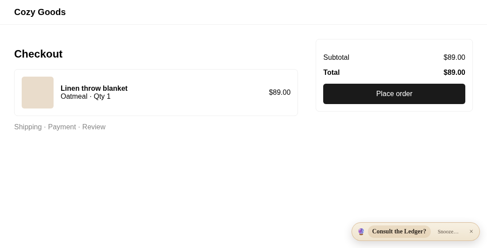
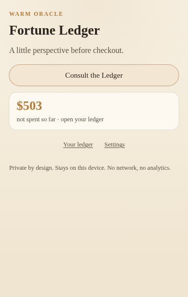
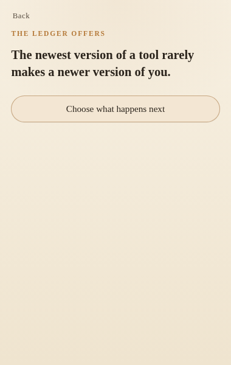
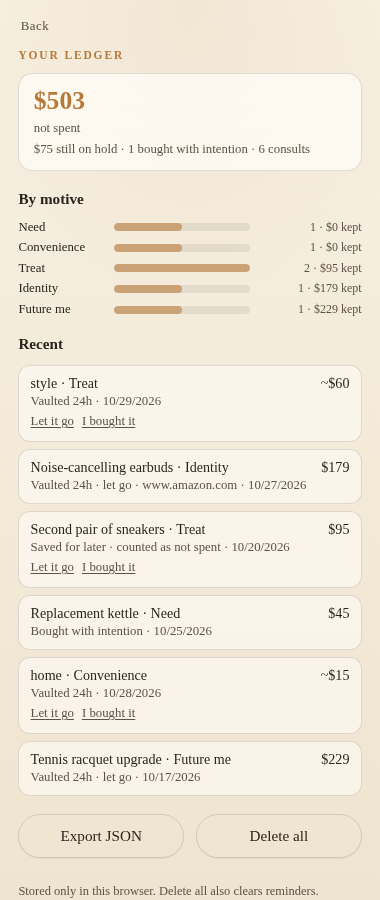
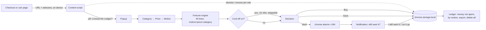

# Fortune Ledger

> **Every checkout removes friction. Fortune Ledger adds a little back, kindly.**

A Chrome extension (Manifest V3) that offers a five-tap moment of reflection before you buy: what is it, roughly what does it cost, what is it really for. It answers with a handwritten fortune, then lets you buy with intention, put the thought in a 24-hour vault, or save it for later. It keeps a private, on-device tally of the money you chose not to spend.



| Welcome | Fortune | Cool-off pause | Ledger |
|---|---|---|---|
|  |  |  |  |

## The problem
Every e-commerce team optimises for one direction: fewer steps, one-click buy, urgency timers, saved cards. Impulse spending is the intended outcome. There is almost nothing on the shopper's side of the screen that slows the moment down, and the tools that exist (budget apps, blockers) either judge you after the fact or block you outright, so people uninstall them.

Fortune Ledger is a deliberately **counter-metric product**: a small, warm piece of friction at the exact moment of impulse, with no judgment and no wall.

## How it works
1. **Detect.** A content script recognises checkout and cart pages (Amazon, Shopify stores, and generic `/checkout`, `/cart`, `/basket` URLs) using the URL and a few well-known selectors only.
2. **Invite, never block.** A small "Consult the Ledger?" pill appears in the corner. Dismiss it, or snooze it per site for 24 hours or for good.
3. **Reflect in five taps.** Category → price range (exact price optional) → motive (Need, Convenience, Treat, Identity, Future me).
4. **Fortune.** One of 40 handwritten lines, chosen deterministically by motive × price × category (no AI API). The most specific match wins; repeat consults rotate.
5. **Optional cool-off.** A 10–60 s breath with a progress ring (off by default; always skippable).
6. **Decide.** Buy with intention / 24-hour vault / save for later. The vault sets a `chrome.alarms` reminder; tomorrow a notification asks "Do you still want it?" with *I still want it* / *Let it go*.
7. **Ledger.** Money not spent, money on hold, a by-motive breakdown, recent history, JSON export, and delete-all.



**"Money not spent"** = vault/save thoughts you explicitly let go, plus vault/save thoughts you did not mark as bought within 7 days. If you gave only a price range, the tally uses a band estimate (~$15 / $60 / $150) and says so.

## Privacy
- **No network.** No servers, no analytics, no telemetry, no AI API. The extension pages ship with `connect-src 'none'` in their CSP.
- **Reads almost nothing.** The content script looks only at the URL and at the presence of a couple of checkout selectors. It does not read prices, product names, or page text.
- **Stored only on device** in `chrome.storage.local`. Export to JSON or delete everything (including pending reminders) from the Ledger screen.

### Permissions, and why each one
| Permission | Why |
|---|---|
| `storage` | Save your ledger, settings, and snoozed sites locally. |
| `alarms` | Fire the 24-hour vault reminder even after the popup is closed. |
| `notifications` | Show that reminder with *I still want it* / *Let it go* buttons. |
| Content-script matches: Amazon `/gp/buy/*`, `/checkout/*`, `/gp/cart/*`, `/cart*`; `*.myshopify.com/cart*`, `/checkouts/*`; `checkout.shopify.com`; `https://*/*checkout*`, `/*cart*`, `/*basket*` | Show the pill only on checkout-like URLs. Path-scoped, not `<all_urls>`. |

No `tabs`, `scripting`, `activeTab`, or `host_permissions` are requested.

## Counter-metrics
The normal funnel celebrates conversion. This product inverts it.

**Success looks like**
- Lower impulse conversion: a falling share of Treat/Identity consults ending in "Buy".
- More vault and save choices, and a growing **money not spent**.
- A rising share of purchases made "with intention" (a buy is a valid, respected outcome).
- People keep it installed because they like it, not because of streaks or guilt.

**Guardrails**
- **Never block a purchase.** The pill never covers or disables the store's button; the pause is skippable.
- **Under 15 s added** per consult by default (five taps; cool-off off by default, and the settings warn above 15 s).
- Low snooze/disable rate per site; if a site gets snoozed a lot, the pill is wrong there.
- Tone: no shame, no red numbers, no "you wasted".

## Install (unpacked)
```bash
npm install
npm run build        # type-check, build popup (Vite), bundle content + service worker (esbuild)
```
1. Open `chrome://extensions` and turn on **Developer mode**.
2. Click **Load unpacked** and pick the `dist/` folder.
3. Pin Fortune Ledger, then visit any store's cart or checkout page.

Screenshots are produced by `scripts/screenshots.mjs` (Playwright + Chromium, loads `dist/` as an extension against a mocked checkout page).

## Stack
React 19, TypeScript, Vite 7, esbuild, Chrome Manifest V3. ~0 runtime dependencies beyond React.

## Roadmap
- Opt-in, on-device price read from the checkout DOM (no more estimates).
- Chrome Web Store listing and a 30-second demo GIF.
- Weekly "letter from the Ledger" summary, still fully local.
